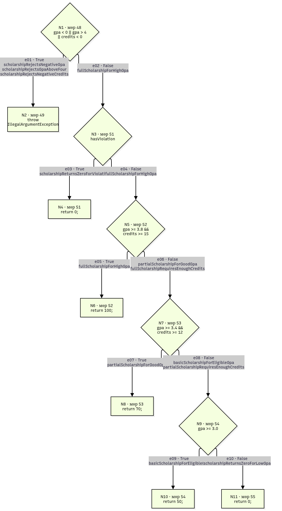

# Лаборатори 9: Код хамралт — JaCoCo

**Нэр:** Б.Дөлгөөн

**Оюутны код:** B242270136

## Ажлын орчин

`java -version` командын бүтэн гаралт:

```text
openjdk version "25.0.5" 2026-10-20
OpenJDK Runtime Environment (build 25.0.5)
OpenJDK 64-Bit Server VM (build 25.0.5, mixed mode, sharing)
```

`mvn -version` командын бүтэн гаралт:

```text
Apache Maven 3.10.0 (c43a36b8d67be7e0805a411bc0898af1a51f5472)
Maven home: /usr/share/java/maven
Java version: 25.0.5, vendor: Arch Linux, runtime: /usr/lib/jvm/java-25-openjdk
Default locale: en, platform encoding: UTF-8, time zone: Asia/Ulaanbaatar
OS name: "linux", version: "7.2.11-arch1-1", arch: "amd64", family: "unix"
```

## Хэсэг A: Happy path тестүүд ба эхний хэмжилт

[ScholarshipCalculatorTest.java](src/test/java/mn/edu/must/sqat/ScholarshipCalculatorTest.java)
файлд хэвийн оролттой дараах таван тест бичсэн.

| Тестийн нэр | Оролт | Хүлээгдэж буй үр дүн |
| --- | --- | --- |
| `letterGradeReturnsAFor95` | `letterGrade(95)` | `"A"` |
| `gpaAveragesTwoGrades` | `gpa([95, 85])` | `3.5` |
| `fullScholarshipForHighGpa` | `scholarship(3.9, 16, false)` | `100` |
| `partialScholarshipForGoodGpa` | `scholarship(3.5, 12, false)` | `70` |
| `basicScholarshipForEligibleGpa` | `scholarship(3.1, 10, false)` | `50` |

### Ажиллуулалт

```bash
mkdir -p results
mvn verify 2>&1 | tee results/mvn-verify-A.txt
cp target/site/jacoco/jacoco.csv results/jacoco-A.csv 
```

**BUILD SUCCESS** — 5 тест ажиллаж, Failures: 0, Errors: 0, Skipped: 0 гарсан.
Бүтэн гаралт [results/mvn-verify-A.txt](results/mvn-verify-A.txt) файлд хадгалагдсан.
JaCoCo-ийн HTML тайлан `target/site/jacoco/index.html` замд үүссэн.

### Эхний хамралт

Тооцоог [results/jacoco-A.csv](results/jacoco-A.csv) файлын
`ScholarshipCalculator` классын мөрөөс авсан.

| Хэмжүүр | Хамрагдсан | Хамрагдаагүй | Нийт | Хамралт |
| --- | ---: | ---: | ---: | ---: |
| Line | 16 | 9 | 25 | 64.00% |
| Branch | 22 | 19 | 41 | 53.66% |

Хамралтын хувь = хамрагдсан / (хамрагдсан + хамрагдаагүй) × 100.

### Тайлангийн ажиглалт

Оролтын хязгаар шалгах нөхцөлүүд, `score >= 80`, `gpa()`-ийн `switch`,
`hasViolation`, тэтгэлгийн `&&` нөхцөлүүд болон `gpa >= 3.0` мөрүүдийн
салаа дутуу хамрагдсан тул шар ромботой харагдсан.
Улаан мөрүүдэд `IllegalArgumentException` шидэх гурван шалгалтын алдааны зам,
C/D/F дүнгийн замууд, мөн бага голчтой үед тэтгэлэг 0 буцаах зам орсон.
Хэвийн оролттой таван тест нь A/B дүн, хоёр дүнгийн голч болон 100/70/50 хувийн
тэтгэлгийг шалгасан учраас эдгээр алдааны болон бусад үр дүнгийн замд хүрээгүй.

## Хэсэг B: CFG зурж branch 100% хүрэх

### Нэмсэн тестүүд

A хэсгийн таван тест дээр дараах 12 тестийг нэмж, нийт **17 тестээр**
Line болон Branch хамралтыг 100% хүргэсэн.

| Тестийн нэр | Шалгасан оролт, үр дүн |
| --- | --- |
| `letterGradeRejectsNegativeScore` | `letterGrade(-1)` → `IllegalArgumentException` |
| `letterGradeRejectsScoreAbove100` | `letterGrade(101)` → `IllegalArgumentException` |
| `gpaUsesAllLetterGrades` | `gpa([95, 85, 75, 65, 55])` → `2.0`; A/B/C/D/F бүх салаа |
| `gpaRejectsNullScores` | `gpa(null)` → `IllegalArgumentException` |
| `gpaRejectsEmptyScores` | `gpa([])` → `IllegalArgumentException` |
| `scholarshipRejectsNegativeGpa` | `scholarship(-0.1, 15, false)` → `IllegalArgumentException` |
| `scholarshipRejectsGpaAboveFour` | `scholarship(4.1, 15, false)` → `IllegalArgumentException` |
| `scholarshipRejectsNegativeCredits` | `scholarship(3.9, -1, false)` → `IllegalArgumentException` |
| `scholarshipReturnsZeroForViolation` | `scholarship(3.9, 16, true)` → `0` |
| `fullScholarshipRequiresEnoughCredits` | `scholarship(3.9, 14, false)` → `70` |
| `partialScholarshipRequiresEnoughCredits` | `scholarship(3.5, 11, false)` → `50` |
| `scholarshipReturnsZeroForLowGpa` | `scholarship(2.9, 16, false)` → `0` |

`gpaUsesAllLetterGrades` нь `switch`-ийн `default` буюу F дүнгийн салааг хамарсан.
`scholarship()`-ийн эхний `||` нөхцөлийн гурван үнэн утгыг тус тусад нь
`assertThrows`-оор шалгасан.
Кредит дутуу хоёр тест нь голч хангагдсан ч `&&` нөхцөлийн кредит шалгах хэсэг
худал болох замуудыг хамарсан.

### scholarship()-ийн CFG



Засварлах эх зураг: [cfg.drawio](cfg.drawio).
`cfg.png` нь draw.io-оос экспортолсон PNG зураг.
Лекцийн `Autumn23-Lecture9-StructuralTesting.pdf`-ийн 15, 19–20, 41-р
хуудсын жишгээр нөхцөлийг ромб, суурь блокийг тэгш өнцөгтөөр дүрсэлсэн.
Зангилаануудыг `N1`–`N11`, ирмэгүүдийг `e01`–`e10` гэж тэмдэглэж,
зангилаа бүрд `ScholarshipCalculator.java` дахь бодит мөрийн дугаарыг бичсэн.
Салаануудыг `True` болон `False` гэж тэмдэглэсэн;
`return` эсвэл `throw` блокт хүрэхэд тухайн зам дуусна.
Ирмэг бүрийн хажууд түүнийг дайрдаг тестүүдийн бодит методын нэрийг бичсэн.

Нийлмэл `if` нөхцөлийг лекцийн 20, 41-р хуудасны жишээ шиг нэг ромбоор
үзүүлсэн. `||` нөхцөлийн үнэн болох гурван хувилбар болон `&&` нөхцөлийн
эхний хэсэг үнэн, хоёр дахь хэсэг худал болох хувилбаруудыг тестүүдээр
тусад нь шалгасан. Зураг нь зөвхөн `scholarship()`-ийн удирдлагын урсгалыг
харуулна; доорх JaCoCo-ийн 41 салаа нь гурван функцийг хамарсан хэмжилт тул
зургийн ирмэгийн тоотой адил биш.

### Ажиллуулалт ба хамралт

```bash
mkdir -p results
mvn verify 2>&1 | tee results/mvn-verify-B.txt
cp target/site/jacoco/jacoco.csv results/jacoco-B.csv
```

**BUILD SUCCESS** — Tests run: **17**, Failures: **0**, Errors: **0**, Skipped: **0**.
Бүтэн гаралт: [results/mvn-verify-B.txt](results/mvn-verify-B.txt).

Тооцоог [results/jacoco-B.csv](results/jacoco-B.csv) файлын
`ScholarshipCalculator` классын мөрөөс авсан.

| Хэмжүүр | Хамрагдсан | Хамрагдаагүй | Нийт | Хамралт |
| --- | ---: | ---: | ---: | ---: |
| Line | 25 | 0 | 25 | 100.00% |
| Branch | 41 | 0 | 41 | 100.00% |

CSV-д **`BRANCH_MISSED = 0`**, **`LINE_MISSED = 0`** болсон.

### AI ашигласан байдал

Засварлах боломжтой CFG зураг болон README-ийн тайлбарыг бэлтгэх

